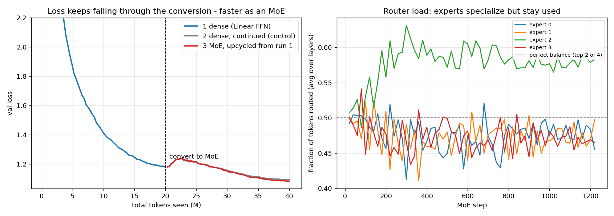

# From a Linear Model to a Mixture of Experts

**ERA Session 14 — train a dense model whose FFNs are plain Linear layers, convert it into an
MoE, and show it keeps training and keeps reducing loss.**

[`dense_to_moe.ipynb`](dense_to_moe.ipynb) is committed with executed outputs; the repo has the
**full training logs** for all three runs (`runs/*/metrics.jsonl`, one record every 20 steps,
plus `runs/*/DONE` summaries). Trained on an Apple M2 Pro (MPS, fp32); the notebook retrains
from scratch on Colab (it clones this repo, and `train_run` resumes from checkpoints / skips
completed runs).

## Setup

- **Data:** enwik8, byte-level (V=256). **Model:** 6-layer transformer, d=512, 8 heads,
  ctx=256 → **19,308,544 params**. Every block's FFN is `Linear(512→2048) → GELU →
  Linear(2048→512)` — the "linear model" part.
- **Conversion = sparse upcycling** (Komatsuzaki et al. 2022): `LM.upcycle(E=4, k=2)` replaces
  each FFN with **4 experts that are exact copies of the trained FFN** plus a fresh top-2 router
  (`Linear(512→4)`). Top-k gate weights are renormalized to sum to 1, so with identical experts
  the MoE computes **exactly the dense function** — whatever the untrained router decides. After
  conversion: **57,115,648 total params, 31,919,104 active per token** (2 of 4 experts).
- Load-balancing: Switch-style auxiliary loss `E·Σ_e f_e·P_e` with coefficient 0.01
  (its balanced value for top-2 of 4 is 2.0).
- Three runs, AdamW (0.9, 0.95), wd 0.1, clip 1.0, batch 64×256, warmup + cosine:

| run | what | tokens | starts from | LR |
|---|---|---|---|---|
| 1 | dense (Linear FFNs), from scratch | 20M | — | 1e-3 |
| 2 | **control:** keep training the dense model | +20M | run 1 weights | 5e-4 |
| 3 | **MoE**, upcycled from run 1, keep training | +20M | run 1 weights | 5e-4 |

Run 2 is the honest baseline: *any* model keeps reducing loss on 20M more tokens, so the
question is whether the MoE reduces it **more** than simply continuing the dense model.

## Results



| run | params (total / active) | final val loss | tok/s | peak mem |
|---|---|---|---|---|
| 1 dense, 20M | 19.3M / 19.3M | 1.1803 | 22,867 | 6.77 GB |
| 2 dense-continue, +20M | 19.3M / 19.3M | **1.0943** | 23,490 | 6.83 GB |
| 3 MoE E=4 top-2, +20M | 57.1M / 31.9M | **1.0841** | 8,699 | 12.91 GB |

**1. The conversion is exactly loss-preserving.** Measured on the real trained model, on the
fixed validation batch, before a single MoE step:

```
[conversion] dense val 1.180338 -> MoE val 1.180338 (|diff| 0.00e+00)
```

No cliff, no re-learning phase — the red curve in the plot leaves the dashed line at exactly
the height the blue curve arrived at. (The tiny-model demo in the notebook shows the same
property to 2e-7 on random weights.)

**2. It keeps training and keeps reducing loss — faster than the dense control.** From the
shared starting point 1.1803, the dense control reaches **1.0943** and the MoE reaches
**1.0841** on the same 20M extra tokens: the MoE is **0.010 lower**, a 9.6% deeper drop
(0.0962 vs 0.0860). That is the expected shape of the upcycling result — modest at this scale
and token budget, because the experts start identical and only earn their extra capacity as
the router sends them different tokens — and it is the right *sign*, against the right
control.

**3. The router actually routes.** Final per-layer expert usage (fraction of tokens whose
top-2 includes each expert; perfect balance for top-2 of 4 is 0.5 each):

```
layer 0  [0.198, 0.452, 0.998, 0.353]   <- a "shared expert" emerged on its own
layer 1  [0.482, 0.542, 0.493, 0.482]
layer 2  [0.520, 0.495, 0.506, 0.479]
layer 3  [0.530, 0.513, 0.474, 0.484]
layer 4  [0.497, 0.483, 0.507, 0.513]
layer 5  [0.503, 0.501, 0.515, 0.481]
```

Layers 1–5 balanced themselves to within a few percent (aux loss 2.09 vs the balanced 2.00).
Layer 0 did something more interesting: expert 2 became a near-universal expert (99.8% of
tokens) with the other three acting as specialists on the second slot — the same structure
DeepSeek-style MoEs *impose* by design as a "shared expert", discovered here by a plain top-2
router at the input layer, where byte-level tokens share the most common structure.

## Findings beyond the headline

- **"Sparse" is not free on unified-memory GPUs.** My first MoE implementation gathered each
  expert's routed tokens (`index_add_` on dynamic sub-batches). On MPS that is a trap: the
  caching allocator keeps a block for every new tensor shape it sees, and each step routes a
  different number of tokens to each expert — "allocated" memory climbed from 17 GB to 39 GB
  on a 32 GB machine, swap set in, and throughput collapsed to 3k tok/s. Fix: evaluate every
  expert on every token and multiply by the gate (exactly zero for unselected experts — same
  outputs, same gradients, verified), plus `torch.mps.empty_cache()` every 50 steps. Memory
  went flat at 12.9 GB. The cost is that this implementation does the FLOPs of a 4-expert
  dense layer (hence 8.7k vs 23k tok/s); the *active-parameter* accounting is real, the
  compute saving is not realized here — on CUDA with grouped GEMMs it would be.
- **An MPS process wedged overnight** at step 1000 with no progress for 7 hours (53% CPU, 2
  minutes of total CPU time). The run was killed and resumed from the step-800 checkpoint
  without losing the curve — checkpoint-and-resume is what turns a lost night into a 15-minute
  fix. (Also caught earlier: `torch.load(map_location="mps")` moves the saved RNG state to the
  GPU, and `Generator.set_state` wants a CPU ByteTensor.)
- **Why upcycle instead of training the MoE from scratch?** Because step 0 of the MoE is a
  free 20M-token head start: all four experts begin as a competent FFN. Training a 57M-param
  MoE from scratch for 20M tokens would not reach 1.08.

## Files

| file | what |
|---|---|
| [`moe.py`](moe.py) | model, `FFN → MoE` upcycling, load-balancing loss, resumable trainer with JSONL logging |
| [`dense_to_moe.ipynb`](dense_to_moe.ipynb) | the whole experiment, executed with outputs |
| [`runs/1_dense/`](runs/1_dense), [`runs/2_dense_continue/`](runs/2_dense_continue), [`runs/3_moe/`](runs/3_moe) | **training logs** (`metrics.jsonl`) and `DONE` summaries |
| [`summary.json`](summary.json) / [`dense_to_moe.png`](dense_to_moe.png) | headline numbers and figure |
| [`build_notebook.py`](build_notebook.py) | generates the notebook |

## Run it

```bash
pip install torch matplotlib
python moe.py --phase dense --tokens 20e6 --lr 1e-3 --out runs/1_dense
python moe.py --phase dense-continue --tokens 20e6 --lr 5e-4 --warmup 100 --init runs/1_dense/model_final.pt --out runs/2_dense_continue
python moe.py --phase moe --tokens 20e6 --lr 5e-4 --warmup 100 --init runs/1_dense/model_final.pt --experts 4 --topk 2 --out runs/3_moe
```
